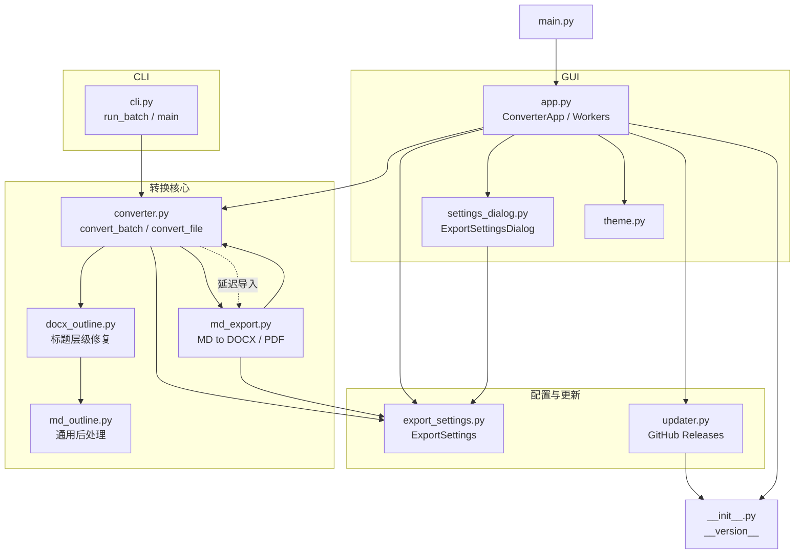
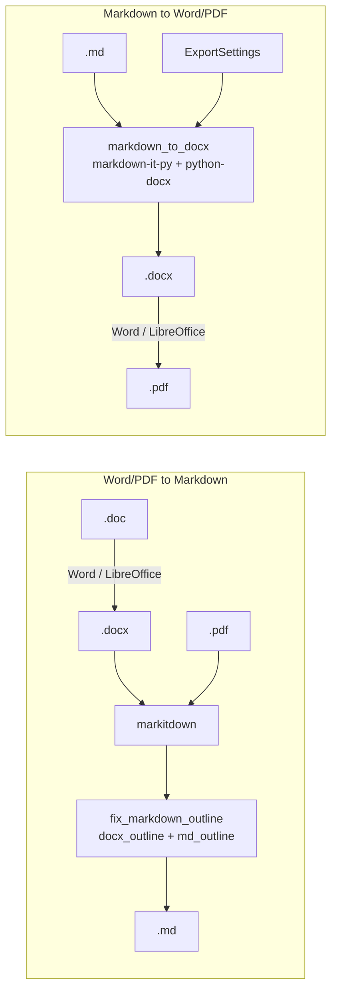
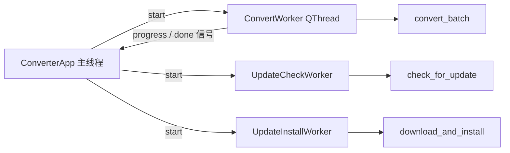

# toMarkdown 工程图谱

> 基于 `tomarkdown/` 包静态分析（AST import 与符号扫描）生成。Python 3.10+，约 3150 行；GUI 为 PySide6，转换引擎为 markitdown / python-docx / markdown-it-py。

## 1. 模块依赖图

箭头表示「导入 / 依赖」。

> 注意：`md_export.py` 顶层导入 `converter`（`ConversionError`、`_find_libreoffice`），而 `converter.py` 在 `_convert_from_md` 内**延迟导入** `md_export` 以避免循环依赖，改动时保持延迟导入。

## 2. 分层

| 层 | 模块 | 职责 |
| --- | --- | --- |
| 入口 | [main.py](../main.py)、[cli.py](../tomarkdown/cli.py) | GUI 启动 / 命令行批量 |
| 界面 | [app.py](../tomarkdown/app.py)、[settings_dialog.py](../tomarkdown/settings_dialog.py)、[theme.py](../tomarkdown/theme.py) | 主窗口、拖拽、导出设置、深浅主题 |
| 转换编排 | [converter.py](../tomarkdown/converter.py) | 方向（Word/PDF→MD、MD→Word/PDF）、文件收集、批量转换 |
| 后处理 | [docx_outline.py](../tomarkdown/docx_outline.py)、[md_outline.py](../tomarkdown/md_outline.py) | 从 docx 编号/样式恢复标题层级，修正 Markdown |
| 导出 | [md_export.py](../tomarkdown/md_export.py) | Markdown → docx（样式、代码高亮、表格、页眉页脚）→ PDF |
| 配置 | [export_settings.py](../tomarkdown/export_settings.py) | 导出设置模型、预设、JSON 持久化 |
| 更新 | [updater.py](../tomarkdown/updater.py) | 检查 GitHub Release、下载并安装 |

## 3. 转换流程

核心调用链：`convert_batch → convert_file → _convert → _convert_to_md / _convert_from_md`
- `_convert_to_md` → `_convert_docx` / `_convert_with_markitdown` / `_convert_doc_to_docx` → `fix_markdown_outline`
- `_convert_from_md` → `md_export.convert_md_to_docx` / `convert_md_to_pdf`

## 4. 关键符号索引

| 文件 | 关键符号 |
| --- | --- |
| [app.py](../tomarkdown/app.py) | `ConverterApp`、`ConvertWorker`、`UpdateCheckWorker`、`UpdateInstallWorker`、`DropFrame`、`run_app` |
| [cli.py](../tomarkdown/cli.py) | `BatchResult`、`run_batch`、`build_parser`、`main` |
| [converter.py](../tomarkdown/converter.py) | `Direction`、`OutputFormat`、`convert_batch`、`convert_file`、`collect_files`、`resolve_output_path`、`ConversionError` |
| [docx_outline.py](../tomarkdown/docx_outline.py) | `NumberingResolver`、`extract_docx_outline`、`apply_docx_outline`、`fix_markdown_outline` |
| [md_outline.py](../tomarkdown/md_outline.py) | `split_images_from_heading`、`_postprocess_common` |
| [md_export.py](../tomarkdown/md_export.py) | `markdown_to_docx`、`convert_md_to_docx`、`convert_md_to_pdf`、`_render_table`、`_add_code_block`、`_apply_export_settings` |
| [export_settings.py](../tomarkdown/export_settings.py) | `ExportSettings`、`load_export_settings`、`save_export_settings`、`build_placeholder_context` |
| [settings_dialog.py](../tomarkdown/settings_dialog.py) | `ExportSettingsDialog`、`ColorField`、`open_export_settings_dialog` |
| [updater.py](../tomarkdown/updater.py) | `ReleaseInfo`、`check_for_update`、`download_and_install`、`is_newer_version`、`is_installed_build` |

## 5. GUI 线程模型

## 6. 测试映射

| 测试 | 覆盖 |
| --- | --- |
| [test_converter.py](../tests/test_converter.py) | `converter.py`（含 `sample.docx` / `sample.pdf`） |
| [test_md_export.py](../tests/test_md_export.py) | `md_export.py` |
| [test_md_outline.py](../tests/test_md_outline.py) | `md_outline.py` / `docx_outline.py` |
| [test_export_settings.py](../tests/test_export_settings.py) | `export_settings.py` |
| [test_updater.py](../tests/test_updater.py) | `updater.py` |

运行：`python -m pytest`。

## 7. 构建与发布

| 文件 | 作用 |
| --- | --- |
| [tomarkdown.spec](../tomarkdown.spec) | PyInstaller 打包 |
| [installer/toMarkdown.nsi](../installer/toMarkdown.nsi) | NSIS 安装包 |
| [.github/workflows/release.yml](../.github/workflows/release.yml) | tag 触发（windows-latest）：安装依赖 → PyInstaller 打包 zip → NSIS setup → Release |
| [build.bat](../build.bat) / [run.bat](../run.bat) | 本地构建 / 运行 |
| [pyproject.toml](../pyproject.toml)、[requirements.txt](../requirements.txt) | 版本与依赖（`__version__` 位于 `tomarkdown/__init__.py`） |

## 8. 说明

- 仓库**尚无** `CODE_MAP.md` / `codemap.mjs`（[codemap-guide.md](codemap-guide.md) 描述的是 Rust/TS 项目的方案，与当前 Python 工程不匹配），本图谱为手工维护的单文件版本。
- 代码变动后（新增模块、依赖变化）需同步更新本文件。
