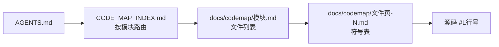

# 代码地图使用教程（给 Agent）

> 目的：让任何 Agent 在改动本仓库代码前，先用「代码地图」定位，再定点读源码，避免全仓扫描。
> 权威说明见 [CODE_MAP.md](../CODE_MAP.md)；项目交接见 [AGENTS.md](../AGENTS.md)。本文只是操作教程，不替代它们。

## 1. 它是什么

- 静态符号索引：记录每个源码文件的函数、结构体、类型、组件等声明及行号。
- **不是**调用关系图，也不替代类型检查、`rust-analyzer` 或测试。
- 全部由 `codemap.mjs` 生成，**禁止手改** `CODE_MAP_INDEX.md` 与 `docs/codemap/`。

## 2. 三层结构



| 层级 | 位置 | 内容 |
| --- | --- | --- |
| 1 索引 | `CODE_MAP_INDEX.md` | 模块名、文件数、符号数 |
| 2 模块页 | `docs/codemap/<模块>.md` | 模块内文件、符号数、符号页链接 |
| 3 符号页 | `docs/codemap/<路径>-<hash>-<页>.md` | Symbol / Kind / Scope / Line（可跳转到源码行） |

每页最多 100 行；符号多的文件会分多页（`-1.md`、`-2.md`…）。

## 3. 定位流程（必须遵守）

1. 读 `CODE_MAP_INDEX.md`，按目录选模块。
2. 打开模块页，找到目标文件，进入对应符号页。
3. 在符号页找到函数/类型的行号，**只读该段源码**。
4. 仅在归属未知时，才在 `docs/codemap` 内搜索符号名（页面可 grep），不要整图加载。
5. 需要调用关系、类型、宏展开时，改用编辑器的引用查找 / `rust-analyzer`。

### 模块速查

| 想找什么 | 模块 | 源码路径 |
| --- | --- | --- |
| 智能网关（解析、冷却、健康、用量限额） | `rust-gateway` | `src-tauri/src/gateway/` |
| Tauri IPC 命令、供应商命令 | `rust-commands` | `src-tauri/src/commands/` |
| 本地代理（Code / Codex / Desktop 等） | `rust-proxy` | `src-tauri/src/proxy/` |
| Antigravity 反代 | `rust-antigravity` | `src-tauri/src/antigravity/` |
| Kiro 反代 | `rust-kiro` | `src-tauri/src/kiro/` |
| 配置写出 | `rust-config` | `src-tauri/src/config/` |
| 数据库 / Schema / 迁移 | `rust-database` | `src-tauri/src/database/` |
| 会话 | `rust-session_manager` | `src-tauri/src/session_manager/` |
| 用量 | `rust-usage` | `src-tauri/src/usage/` |
| 额度探测 | `rust-quota` | `src-tauri/src/quota/` |
| Rust 根级文件（`lib.rs`、`agents.rs` 等） | `rust-root` | `src-tauri/src/*.rs` |
| 前端页面 | `web-pages` | `src/pages/` |
| 前端组件 | `web-components` | `src/components/` |
| 前端服务 / 状态 / 工具 / 类型 / i18n | `web-services` / `web-stores` / `web-utils` / `web-types` / `web-i18n` | `src/services/` 等 |
| 脚本 / 系统测试 | `scripts-root` / `scripts-system-test` | `scripts/` |
| 地图生成器自身 | `tooling` | `codemap.*.mjs` |

模块页只是目录路由，实际文件以 `CODE_MAP_INDEX.md` 为准。

### 示例

任务：修改 `count_tokens` 在网关中的行为。

1. 索引 → `rust-gateway`。
2. `docs/codemap/rust-gateway.md` → 找到 `src-tauri/src/gateway/count_tokens.rs`。
3. 符号页列出 `handle`、`local_estimate_response`、`forward_anthropic` 及行号。
4. 只读这些函数；用 `usages` / `rust-analyzer` 查调用方。

## 4. 符号页字段说明

| 列 | 含义 |
| --- | --- |
| Symbol | 符号名；宏调用显示为 `macro invocation (unexpanded)` |
| Kind | 语法类型（`function_item`、`struct_item`、interface 等） |
| Scope | 词法所在的父级（impl / 函数 / 类），仅作导航，不是类型解析结果 |
| Line | 声明行，链接到源码 `#L行号` |

## 5. 命令

需要 Node 22+ 与 pnpm 9.15；首次先 `pnpm install --frozen-lockfile`。

```powershell
pnpm codemap                      # 增量生成（首次 / 配置变化后用这个）
pnpm codemap --module rust-gateway # 只刷新单模块；需已有缓存，且改动不得越出该模块
pnpm codemap:check                 # 只检查，不写文件；有漂移则退出码非 0
pnpm codemap:test                  # 工具自测
pnpm codemap:benchmark             # 基准
pnpm codemap:hook                  # 安装可选 pre-commit（不会覆盖已有 hook）
```

- 本地缓存 `.codemap-cache.json` 可随时删除，已被忽略。
- 生成结果不含时间戳与机器路径，可复现。

## 6. 改完代码后的必做清单

1. 完成改动并跑最小相关验证（`cargo test --lib ...`、`pnpm lint`、`pnpm build` 等，见 [build-test.md](agents/build-test.md)）。
2. 任何文件新增 / 编辑 / 删除 / 重命名后执行 `pnpm codemap`；非代码改动也执行一次。
3. 执行 `pnpm codemap:check`，必须零漂移。
4. 检查并一并纳入 `CODE_MAP_INDEX.md`、`docs/codemap/` 的变化，确认解析诊断为 0。
5. 汇报实际验证结果与未覆盖项。

CI 会强制 `codemap:check`，忘记重新生成会失败。

## 7. 覆盖范围与限制

- 索引范围：`src`、`src-tauri`、`scripts` 与根工具脚本；扩展名 `.rs .ts .tsx .js .mjs .cjs .py .ps1 .bat .sh`。
- 排除：`examples`、`node_modules`、`target`、`dist`、`release`、`generated`、`gen`、`.git`、`artifacts` 等；未被 Git 跟踪且被忽略的文件、符号链接也不收录。
- 不收录：`import`、普通参数、局部 `let`、匿名回调、对象字面量键、宏展开结果、`build.rs` 生成的声明。
- `cfg` 分支不区分目标平台，一律静态收录。
- PowerShell / BAT 仅做词法级导航，可能误匹配注释或字符串中的声明。
- 解析器报告恢复诊断时，以源码为准。
- `docs/codemap/` 专属生成器，**不要在其中放手写文档**；本教程位于 `docs/` 根目录。

## 8. 常见问题

| 现象 | 处理 |
| --- | --- |
| `pnpm codemap:check` 报漂移 | 运行 `pnpm codemap` 后重新检查，再把生成页纳入提交 |
| `--module` 报缓存无效或越界 | 改用无参数 `pnpm codemap` |
| 找不到符号 | 确认文件在索引范围内；宏生成或局部变量不收录；改用编辑器引用查找 |
| 符号页分了多页 | 模块页的「Symbol pages」列列出全部页码 |
| 想手改地图 | 禁止。改源码后重新生成 |

## 9. 给其他 Agent 的提示词模板

```text
先读 AGENTS.md 与 docs/codemap-guide.md。
任何代码任务：从 CODE_MAP_INDEX.md 选模块 → 文件符号页 → 定点读源码，不要全仓扫描。
修改后执行 pnpm codemap 与 pnpm codemap:check，并把 CODE_MAP_INDEX.md 与 docs/codemap/ 的变化一起纳入。
禁止手改生成地图；遵守 AGENTS.md 中的硬约束与最小改动原则。
```
